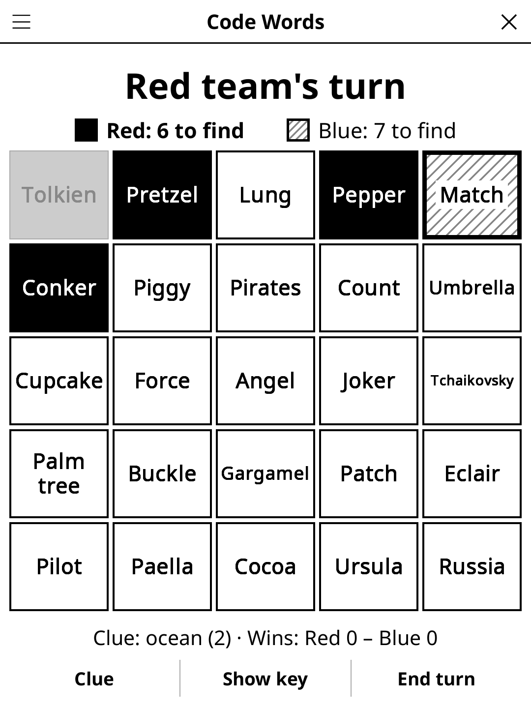

# codewords.koplugin

**Code Words** (FR *Mots de code*) — a team word-association party game for
[KOReader](https://github.com/koreader/koreader). Put the reader in the middle
of the table: two spymasters, two teams of field operatives, 25 words.

## Screenshot



## Rules

- Two teams, **Red** and **Blue**. Each picks a spymaster; everybody else is
  a field operative.
- A secret key says which of the 25 words are Red agents, Blue agents, neutral
  bystanders, and which one is the **assassin**. The starting team has 9
  agents, the other 8 (7 bystanders, 1 assassin).
- Only the spymasters see the key: **Show key**, operatives look away, tap the
  screen. Any tap hides it again (with a full e-ink refresh, so no ghost of the
  key stays on the panel).
- On its turn, a spymaster gives a one-word clue and a number (“ocean 2”).
  **Clue** shows it in the status line. Operatives tap words to reveal them:
  - own agent → keep guessing, up to the number + 1;
  - bystander or enemy agent → the turn ends;
  - the assassin → that team loses at once.
  **End turn** stops guessing early.
- A team wins when all its agents are revealed — even if the other team
  revealed the last one. Wins are counted across games.

## E-ink patterns

No colours on e-ink, so revealed cards use patterns:

| Card | Look |
|------|------|
| Red agent | solid black, white word |
| Blue agent | diagonal stripes, thick border, word on a white plate |
| Bystander | light grey |
| Assassin | black with a white X |

In the key view (and once the game is over) every card shows its role, and a
notch in the corner marks the cards already revealed.

## Features

- 5×5 grid sized to the screen; long words shrink, names with a space or a
  hyphen go on two lines.
- Fresh words on every grid: the words already dealt are remembered, and a
  word only comes back once every word of the selected packs has been on a
  grid (about 70 grids with all packs).
- Word packs, picked in the menu (**Packs: all** or any mix); each grid draws
  from the selected packs only, and each pack is a file loaded only when a grid
  is dealt. Common nouns mixed with famous names and places (Napoléon,
  Einstein, Astérix, Égypte, Eiffel, Titanic, Lune, Jupiter…):

  | Pack | EN | FR |
  |------|----|----|
  | Classic words | 500 | 440 |
  | History & famous people | 264 | 263 |
  | Geography & monuments | 264 | 272 |
  | Pop culture | 240 | 240 |
  | Science & nature | 240 | 240 |
  | Food | 232 | 240 |
  | Kids | 240 | 240 |

  1873 distinct English words, 1785 French (a few words sit in two packs). The
  word language is its own setting (**Language: FR/EN**), defaulting to
  KOReader's language; the interface follows KOReader.
- The game in progress is saved when the screen closes; a finished game comes
  back with **New game** in the action bar.

## Double Agents (two readers)

**Double Agents** (FR *Agents doubles*) is a cooperative mode for two players
with a reader each, under **Tools → Games → Two readers**.

- One player starts a game and reads its five-digit code aloud; the other
  joins with it. The code carries the language of the words and the number
  of turns, so both readers deal the same 25 words.
- Each reader shows its own player's key: 9 agents (black cards) and 3
  assassins (crossed out). The keys overlap: 15 agents to find in all.
- Players take turns giving a clue for the agents of their own key. Both tap
  the guessed word on their reader (twice, to confirm), so the readers stay
  in step; the guess is judged on the clue giver's key: an agent is found, a
  bystander ends the turn, an assassin loses the game.
- Find all 15 agents within 11 (relaxed) or 9 (standard) turns. A corner
  triangle marks a word the other player's key calls a bystander; Undo takes
  back the last entry on both readers.

## Installation

Copy `codewords.koplugin/` into KOReader's `plugins/` folder, with the shared
`game-common/` library as its `common/` folder (the release zip includes it).
**Code Words** then appears in the Tools menu.

## Development

`board.lua` is the game logic (no UI); `test_board_spec.lua` covers it and the
word packs (sizes, duplicates, excluded names):

```
busted test_board_spec.lua
```

## License

GPL-3.0
